<p align="center">
  <picture>
    <source media="(prefers-color-scheme: dark)" srcset="https://raw.githubusercontent.com/speedyrulz/ComfyUI-RulZnodes/main/assets/logo-dark.png">
    
  </picture>
</p>

<h1 align="center">ComfyUI-RulZnodes</h1>

<p align="center">
  Nodes for ComfyUI: load HEIC photos with their filename, pick images from a sidebar browser or step through a
  folder one image per run, crop to a mask with sensible padding, resize with megapixel and input-size targets,
  remove honeycomb skin texture, turn off the Comfy compiler per workflow, pick a random prompt from a text file,
  mask a person by clicking them, and run Qwen Image 2.1 attention block-sparse.
</p>

## Nodes

| Node | What it does |
|---|---|
| [**RulZ Load Image (HEIC)**](#rulz-load-image-heic) | `LoadImage` replacement that also loads `.heic` / `.heif` and outputs the filename. |
| [**RulZ Load Image Batch (HEIC)**](#rulz-load-image-batch-heic) | The HEIC loader with a list: drop several photos on it and each queued run uses the next one. |
| [**RulZ Image Browser**](#rulz-image-browser) | Sidebar tab, not a graph node: browse a folder as thumbnails, select images and send them to RulZ Load Image Batch (HEIC). |
| [**RulZ Simple Load Image Batch**](#rulz-simple-load-image-batch) | Walks through every image in a folder, one image per queued run, and resumes where it stopped. |
| [**RulZ Mask Intelligent Crop**](#rulz-mask-intelligent-crop) | Crops an image and/or mask to the mask's bounding box plus padding, with an aspect limit and divisible-by snapping. |
| [**RulZ Resize Image Advanced**](#rulz-resize-image-advanced) | KJNodes-style Resize Image v2 that can take its target size from an input image, scale it by a factor or to a megapixel total, and shows the output resolution on the node. |
| [**RulZ DeskinTexture**](#rulz-deskintexture) | Removes the honeycomb / orange-peel skin texture restoration models leave behind and puts natural grain back. |
| [**RulZ Disable Comfy Compiler**](#rulz-disable-comfy-compiler) | Per-workflow replacement for the `--disable-comfy-compiler` launch flag. |
| [**RulZ Random Prompt Selector**](#rulz-random-prompt-selector) | Outputs a random line from a text file of prompts, chosen by the seed. |
| [**RulZ Person Select (SAM3)**](#rulz-person-select-sam3) | Load an image, click a person on the node, and get a mask of that person and a mask of everyone else. |
| [**RulZ Qwen Sparse Sage Attention**](#rulz-qwen-sparse-sage-attention) | Block-sparse SageAttention for Qwen Image 2.1: sampling steps take about 23% less time at 4 MP, with SageAttention's quality. |

All nodes are in the **RulZnodes** category of the node menu.

## Install

**ComfyUI-Manager:** open **Custom Nodes Manager**, search for **RulZnodes** and install it. Or, with
[comfy-cli](https://github.com/Comfy-Org/comfy-cli): `comfy node install comfyui-rulznodes`.

**Manually:**

```
cd ComfyUI/custom_nodes
git clone https://github.com/speedyrulz/ComfyUI-RulZnodes
pip install -r ComfyUI-RulZnodes/requirements.txt
```

Use ComfyUI's own Python for the `pip install`. Restart ComfyUI and hard-refresh the browser.

The only requirement is `pillow-heif`, and only for HEIC/HEIF. Without it the other nodes work as normal and
the HEIC loaders handle the usual formats only (the console says so at startup). A few nodes need more, which
is not installed for you:

| Node | Needs |
|---|---|
| RulZ Person Select (SAM3) | A ComfyUI version with built-in SAM 3 support and a SAM 3 or SAM 3.1 checkpoint in `models/checkpoints`. |
| RulZ Qwen Sparse Sage Attention | SageAttention 2 (`sageattention`), an RTX 40 or RTX 50 GPU, the CUDA toolkit (`nvcc`), `ninja` and a C++ compiler. |
| RulZ Resize Image Advanced, `nvidia_rtx_vsr` method only | The `nvidia-vfx` library and an NVIDIA RTX GPU. |

> **Coming from the standalone packs?** Remove `ComfyUI-image-load-filename-heic`, `load-image-batch-simple`,
> `mask-intelligent-crop`, `resize-image-v2-advanced`, `ComfyUI-DeSkin` and `ComfyUI-DisableComfyCompiler` from
> `custom_nodes`.
> The node IDs are unchanged (only the display names gained a "RulZ" prefix), so existing workflows keep
> working, but with both installed the same nodes are registered twice.

---

## RulZ Load Image (HEIC)

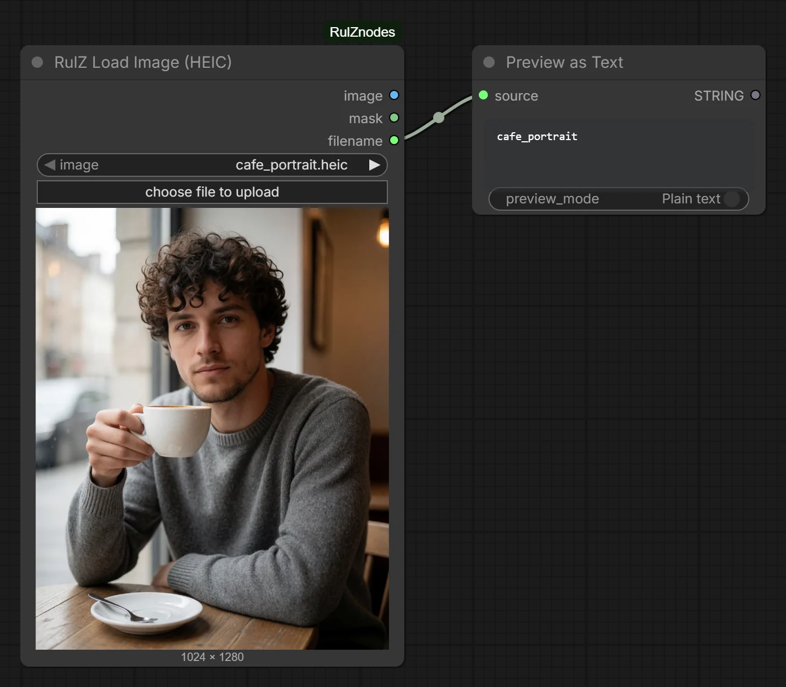

`LoadImageWithFilenameHEIC`: a `LoadImage` replacement that also loads `.heic` / `.heif` files and outputs the filename.

| Output | Description |
|---|---|
| `image` | The image. Files with several frames (animated GIF or WebP, multi-page TIFF) load as a batch; frames whose size differs from the first are skipped. |
| `mask` | 1 − alpha, so transparent areas are white. Palette transparency counts too. All black when the image has no transparency. |
| `filename` | The file's name without folder or extension, e.g. `IMG_0042`. |

- Lists PNG, JPEG (`.jpg`, `.jpeg`, `.jfif`), WebP, BMP, GIF and TIFF files from the top level of ComfyUI's
  `input` folder, plus HEIC / HEIF when `pillow-heif` is installed. Files in subfolders are not listed.
- The upload button's file picker is widened to allow HEIC/HEIF, and HEIC files are accepted even when
  Windows reports no MIME type for them (`web/heic_upload.js`).
- Previews: browsers can't render HEIC, so `heic_preview.py` adds a middleware that serves `.heic` / `.heif`
  files as JPEG from ComfyUI's `/view` endpoint. The conversion happens in memory; no extra files are created.
- EXIF rotation is applied, so phone photos come out upright.
- 16-bit greyscale PNG / TIFF files load at their full range (the stock conversion turns them almost white).
- Multi-picture JPEGs (MPO, from many phones and cameras) load as the main photo only, not as a batch with
  the hidden second view or depth map.

## RulZ Load Image Batch (HEIC)

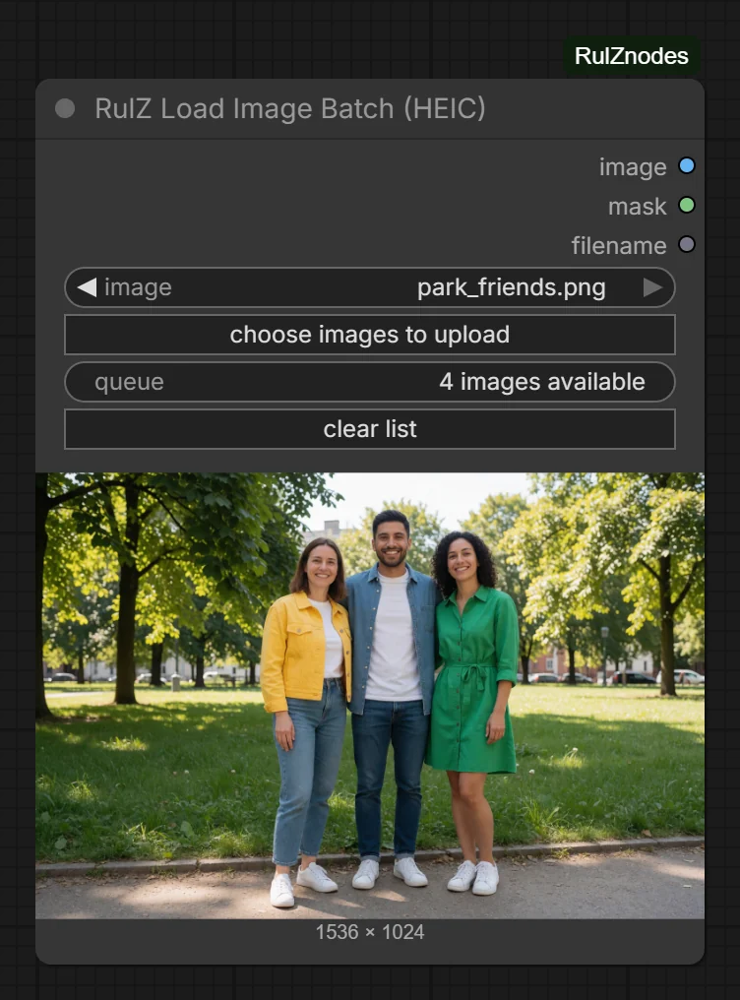

`LoadImageBatchHEIC`: the same loader and outputs as **RulZ Load Image (HEIC)**, but it holds a list of images.

- Drag several images onto the node, or pick several with **choose images to upload**, to add them to the list.
  They are uploaded to ComfyUI's input folder and added in natural filename order (`img2` before `img10`).
  Dropping more adds them to the end. If an upload fails, an error message names the file and the reason.
- The `queue` line shows how many images are available (*drop images here* when the list is empty), and the
  preview shows the first one.
- Each queued run uses the first image and then moves on: the count drops by 1 and the preview shows the next
  image. On the last image it stays put and the count stays at 1. Images added after that replace it.
- Picking a file from the `image` dropdown or pasting an image adds it to the list too. **clear list** empties
  the list.
- The list is saved with the workflow (in the node's properties), so it survives a reload.

## RulZ Image Browser

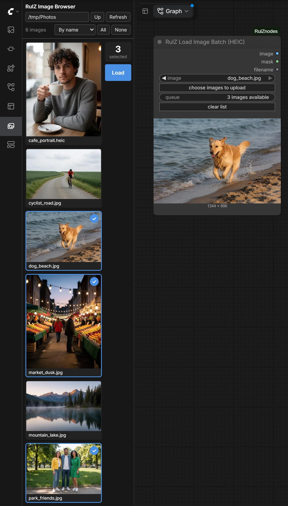

A tab in ComfyUI's left sidebar (the **RulZ Images** button) rather than a node in the node menu. It fills
**RulZ Load Image Batch (HEIC)** from a folder without dragging files in from a file manager. It needs a
ComfyUI frontend with sidebar tabs; on an older one the console says the browser is unavailable.

- Type or paste a folder path and press Enter, or move around with the folder list and **Up**. On Windows,
  **Up** from a drive root lists the drives. **Refresh** reloads the folder and keeps the selection.
- The first time it opens it shows the last folder used, or else your home folder.
- Folders and images whose names start with `.` or `$` are not listed.
- The folder's images are shown as one column of thumbnails, **By name** or **Newest first**. HEIC / HEIF files
  are included when `pillow-heif` is installed.
- Click a thumbnail to select or deselect it; Shift-click selects the range from the last clicked one.
  **All** and **None** select or clear the whole folder. Opening another folder clears the selection. The
  counter to the right of the thumbnails shows how many are selected; it and the **Load** button stay in view
  while you scroll.
- **Load** adds the selected images to the batch node's list in the order shown, the same as dropping them on
  the node, and then clears the selection. Images from outside ComfyUI's input folder are copied into it. An
  image that is already in the input folder (or a subfolder of it) is used where it is, and one with the same
  name and content as a file there is not copied again. A different file with the same name is copied as
  `name (1).jpg`.
- The images go to the selected RulZ Load Image Batch (HEIC) node. With none selected they go to the first one
  in the workflow (subgraphs included), and the message names its node number if there are several. If the
  workflow has none, one is added.
- The folder is read on the machine that runs ComfyUI, so with a remote ComfyUI it browses that machine. Any
  browser that can reach your ComfyUI can use this tab's routes to list folders, view thumbnails of any image
  on that machine and copy images into the input folder, where ComfyUI serves them at full size. Keep that in
  mind if you start ComfyUI with `--listen`.

## RulZ Simple Load Image Batch

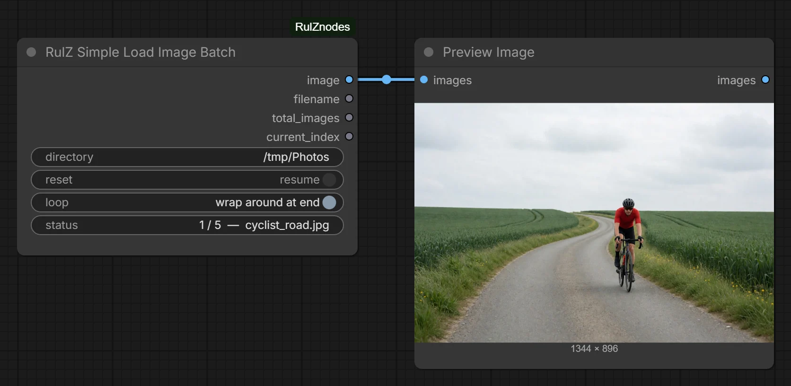

`LoadImageBatchSimple`: walks through every image in a directory, one image per queued run.

| Input | Description |
|---|---|
| `directory` | Folder to read. Empty (the default) reads ComfyUI's `input` folder. `~` and paths in quotes (Windows **Copy as path**) work. The image count is detected automatically. |
| `reset` | Default off (**resume**): continue from where the last run stopped. On (**restart from first image**): start from the first image. While it is on, every run loads the first image, so turn it off again after one run. |
| `loop` | Default on (**wrap around at end**): go back to the first image after the last one. Off (**stay on last image**): keep returning the last image. |

**Outputs:** `image`, `filename` (with extension), `total_images`, `current_index` (0-based). There is no mask
output. After each run the node shows `current / total — filename`.

- Reads PNG, JPEG, WebP, BMP, GIF and TIFF files from the folder itself, not its subfolders. HEIC is not
  supported here; use **RulZ Load Image Batch (HEIC)** for that.
- Images are taken in natural filename order (`img2` before `img10`).
- Progress is saved per directory in `ComfyUI/user/rulznodes/batch_state.json`, so queueing 5 runs and then 5
  more covers all 10 images, even across a ComfyUI restart or an update of this pack. Files added to or removed
  from the folder are picked up on the next run.
- A folder that doesn't exist or has no images stops the run with an error naming it.

## RulZ Mask Intelligent Crop

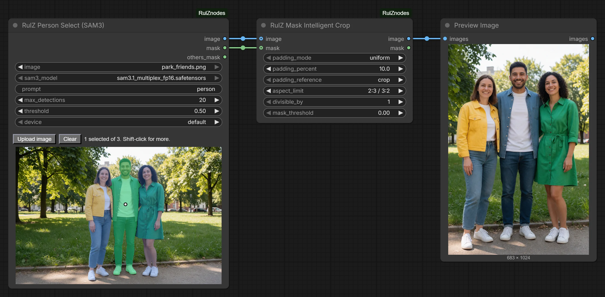

`MaskIntelligentCrop`: crops an image and/or mask to the bounding box of the mask, then extends **every side**
of that box by a percentage (default 10%), either the same on all sides or set per edge. By default the
percentage is measured against the **final crop**, so the subject ends up inside a 10% border. The padded box
is clamped to the image bounds.

In the screenshot the mask is the man in the middle. A standing person is taller than 2:3, so the default
`aspect_limit` widens the crop and his friends show at the sides.

| Input | Description |
|---|---|
| `image` (optional) | Image batch to crop. |
| `mask` (optional) | Mask that defines the crop. It can have a different resolution from the image: the box is found on the mask as it is and scaled to the image, and the mask output is resized to the image (bilinear) before cropping. |
| `padding_mode` | `uniform` (default): `padding_percent` is used on every side. `per_edge`: `padding_top`, `padding_bottom`, `padding_left` and `padding_right` set each side separately. The node only shows the fields for the selected mode. |
| `padding_percent` | `uniform` mode. How far each side extends beyond the masked area. Left/right use this percentage of the reference **width**, top/bottom of the reference **height**. 0 to 100, default `10`. |
| `padding_top` / `padding_bottom` / `padding_left` / `padding_right` | `per_edge` mode. How far that one side extends beyond the masked area, as a percentage of the reference **height** (top/bottom) or **width** (left/right). 0 to 100, default `10` each. |
| `padding_reference` | What the percentages are measured against. `crop` (default): the final cropped image, so each border is that share of the output. Two opposite borders together are capped at 90% and scaled down evenly beyond that, so a `uniform` value above 45 acts as 45. `mask`: the mask bounding box. `image`: the full input image. |
| `aspect_limit` | Never crop more elongated than this ratio: `off`, `1:1`, `4:5 / 5:4`, `3:4 / 4:3`, `2:3 / 3:2` (default) or `9:16 / 16:9`. A crop that would be taller than the limit is widened, one that would be wider is heightened, centred on the subject and clamped to the image. The crop is only ever grown, never shrunk. |
| `divisible_by` | Grow the crop so width and height are multiples of this value (1 to 1024). `1` (default) disables it. The crop is only ever shrunk when the image is too small to grow, and never into the masked area. If neither works, that side uses the full image width or height, which may not be a multiple. |
| `mask_threshold` | Mask pixels above this value count as masked. Default `0` (any non-zero pixel). |

| Output | Description |
|---|---|
| `image` | Cropped image. `None` if no image was connected. |
| `mask` | Cropped mask, in image coordinates. |

- **image + mask**: both are cropped to the same box.
- **mask only**: the mask is cropped, the image output is `None`.
- **image only**: nothing to crop by, so the image passes through unchanged with a blank (all zero) mask of the same size.
- **neither**: the run stops with an error.
- **empty mask**: inputs are returned at full size.
- **batches**: the crop box is the union over the whole mask batch, so every frame is cropped to the same size.
  The mask output keeps the mask's own number of frames.
- The border shares hold for the padded box. Clamping to the image, `aspect_limit` and `divisible_by` can
  change them afterwards.
- Workflows saved before the per-edge fields existed load with their `padding_percent` in uniform mode.

## RulZ Resize Image Advanced

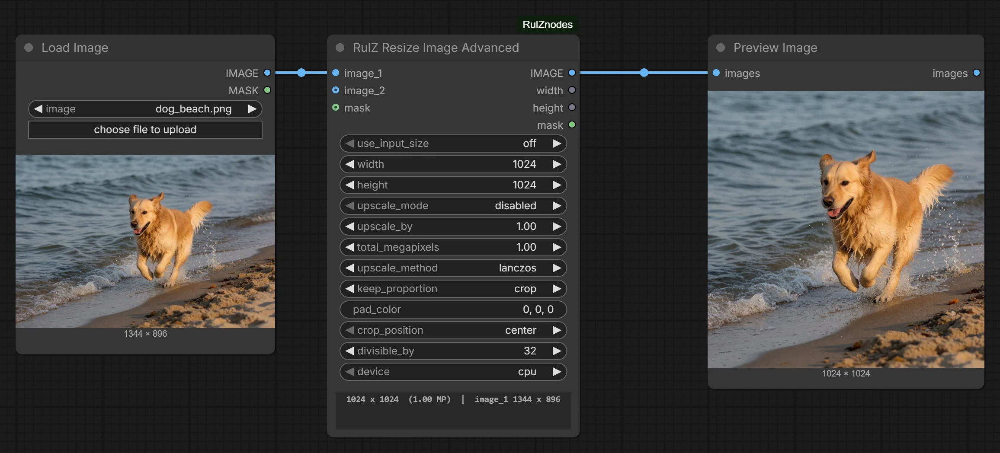

`ResizeImageV2Advanced`: a standalone clone of the KJNodes **Resize Image v2** node with extra sizing controls.
No dependency on ComfyUI-KJNodes.

| Input | Description |
|---|---|
| `image_1` | The image that gets resized. |
| `image_2` (optional) | A second image used **only for its width/height**. The output is always a resized `image_1`. |
| `mask` (optional) | Resized and cropped or padded along with the image. |
| `use_input_size` | `off` (default) / `image_1` / `image_2`. Uses that image's width/height as the `width`/`height` settings. With `divisible_by` set, the output is the closest resolution to that image that is divisible. `image_2` with no `image_2` connected stops the run with an error. |
| `width` / `height` | Target size. Default `512` x `512`. `0` takes that edge from `image_1`: in `resize`, `total_pixels` and the pad modes, and whenever `upscale_mode` is on, it follows `image_1`'s aspect ratio; in `stretch` and `crop` it is `image_1`'s own width or height (as in KJ's original). |
| `upscale_mode` | `disabled` (default) / `upscale_by` / `total_megapixels`. Applied to the target size (`width` x `height`, or the input size from `use_input_size`), before the `keep_proportion` logic runs. It does not scale `image_1` itself unless the target size comes from it. |
| `upscale_by` | 0.01 to 100. Multiplies both edges of the target size. |
| `total_megapixels` | 0.01 to 1000. Rescales the target size (keeping its aspect ratio) to that total pixel count. 1 MP = 1024×1024 px, same as ComfyUI's *ImageScaleToTotalPixels*. After rounding to `divisible_by` the total is approximate. |
| `upscale_method` | `nearest-exact`, `bilinear`, `area`, `bicubic`, `lanczos` (default) or `nvidia_rtx_vsr`. `lanczos` is CPU only: with `device` = `gpu` it stops with an error. |
| `keep_proportion` | `stretch`, `resize`, `pad`, `pad_edge`, `pad_edge_pixel`, `crop` (default), `pillarbox_blur` or `total_pixels`. |
| `pad_color` | Colour of the padding, `pad` mode only (the other pad modes use the image's edge or a blur). `R, G, B`, `R, G, B, A`, values from 0 to 1 as fractions, `#RRGGBB`, `#fff`, `#RRGGBBAA`, a colour name or one grey value. An alpha value is dropped for RGB images. Anything it can't read falls back to black with a warning in the console. Default `0, 0, 0`. |
| `crop_position` | `center` (default), `top`, `bottom`, `left` or `right`. In `crop` mode it picks the part that is kept; in the pad modes it picks the side the image sits against. |
| `divisible_by` | 0 to 512, default `32`. All computed sizes are rounded to the **nearest** multiple (KJ's original rounds down), but never below one multiple. `0` or `1` turns rounding off. In the pad modes (`pad`, `pad_edge`, `pad_edge_pixel`, `pillarbox_blur`) the rounded size is the canvas: the image is fitted inside it and the rest is padding, so the output is exactly that size. |
| `device` (optional) | `cpu` (default) or `gpu`. |

| Output | Description |
|---|---|
| `IMAGE` | The resized image. Batches of more than 64 images are processed 64 at a time. |
| `width` / `height` | The output size. |
| `mask` | The resized mask. In the pad modes it is white over the padding when no mask is connected. With no mask connected in the other modes it is an empty 64×64 mask, and a connected 64×64 mask is treated as no mask (ComfyUI's placeholder). |

After a run the node shows `W x H  (MP)  |  image_1 W x H`, plus `|  image_2 W x H` when `image_2` is
connected. Before the first run it reads *output resolution (run to compute)*.

Everything else (the resize, pad, crop and pillarbox modes, mask handling, the GPU option and the NVIDIA RTX
VSR method) matches the original. The `nvidia_rtx_vsr` method needs the `nvidia-vfx` library and an NVIDIA RTX
GPU.

## RulZ DeskinTexture

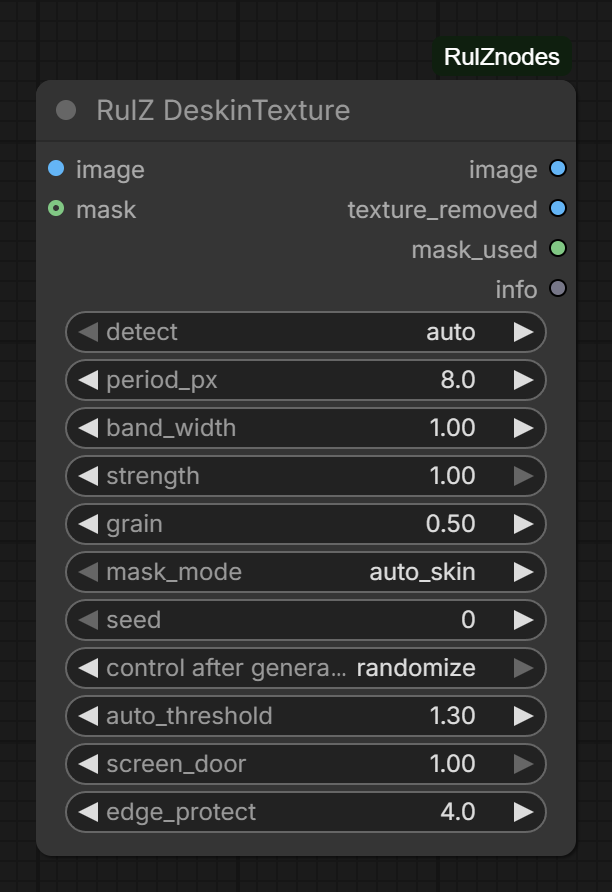

`DeSkinTexture`: removes the honeycomb / "orange-peel" texture that image restoration models (Qwen-Image and
others) sometimes paint onto skin, and puts believable grain back so the result doesn't look like wax.

It measures the image's frequency spectrum, finds the band of detail sizes where the fake pores stick up above
the natural curve of a real photo, cuts only that band, and refills it with random, non-lattice texture. Larger
shapes, shading and finer edges are untouched. A separate step (`screen_door`) notches out the exact 2 / 4 / 8 px
grid that a VAE leaves behind. It needs no extra packages and falls back to the CPU if the GPU runs out of memory.

| Input | Description |
|---|---|
| `image` | Image batch. RGBA is fine; the alpha channel is kept. For a batch, detection uses the median over the frames, so every frame gets the same fix. |
| `mask` (optional) | White = apply the fix. Overrides `mask_mode`. A face-parsing or SAM skin mask gives the cleanest result. If the mask covers less than 0.5% of the image (this includes an `auto_skin` mask that finds almost no skin), the image passes through unchanged. |
| `detect` | `auto` (default) finds the pattern size from the spectrum: cells of about 2 to 33 px. `manual` uses `period_px`. |
| `period_px` | Pattern cell size in pixels, `manual` mode only. 2 to 256, default `8`. |
| `band_width` | How wide a band of detail sizes to remove, relative to the detected size. Lower keeps more real pores but may leave some pattern. 0.2 to 3, default `1`. |
| `strength` | How completely the band is removed. 0 to 1, default `1`. It does not affect `screen_door`. |
| `grain` | Random texture put back, as a fraction of what was removed at each spot. `0` = none (waxy), `0.7`-`0.9` = more skin-like. 0 to 2, default `0.5`. |
| `mask_mode` | Used only with no mask connected. `auto_skin` (default): a rough skin-colour mask. `whole_image`: everything. |
| `seed` | Grain pattern seed. |
| `auto_threshold` | `auto` only applies the fix if the pattern is at least this many times the natural level inside the mask. Otherwise the image passes through and `info` names the size it found. 1 to 10, default `1.3`. |
| `screen_door` | Removes the fine pixel-aligned 2 / 4 / 8 px grid, inside the mask only. `0` = off. 0 to 1, default `1`. |
| `edge_protect` | Holds the fix back where the removed texture is stronger than this many times its typical level (lips, eyes, hems), and leaves a no-filter zone next to strong edges so silhouettes don't pick up a halo. **Lower values protect more**, but `0` turns it off rather than being the strongest setting. 0 to 20, default `4`. |

| Output | Description |
|---|---|
| `image` | The fixed image. |
| `texture_removed` | What was taken out, amplified ×8 around mid-grey. A clean lattice on grey means the settings are right. |
| `mask_used` | The mask that was applied. Use it to check the auto skin mask. |
| `info` | Detected cell size and strength, mask coverage and amount removed. Connect it to a **Preview Any** node to read it; it is also printed in the console. |

**Tuning:**

- **Use a real skin mask when you can.** `auto_skin` is only a colour test: it can take wooden doors and warm
  fabrics and miss very pale or warm-lit skin. Detection is measured inside the mask, so a good mask also makes
  `auto` far more reliable.
- **Pattern still visible:** raise `band_width` to `1.3`-`1.5`, or switch to `manual` with the cell size measured
  at 100% zoom. A zoomed screenshot will fool you.
- **Pattern survives next to an edge:** raise `edge_protect` to `6`-`8`. Real edges that soften, or a band or halo
  along a silhouette, mean the opposite: lower it to `2`-`3`.
- **Too smooth or too noisy:** raise or lower `grain`.
- **Fine striping at 100%:** that's the screen door, which is only fixed inside the mask. For a background that has
  it too, run a second node with `detect` = `manual`, `mask_mode` = `whole_image`, `strength` `0` and
  `screen_door` `1` (`manual`, so `auto` doesn't pass the image through when it finds no honeycomb).
- **Wrong size detected:** `auto` picks the strongest pattern, which can be fabric or hair if the honeycomb is
  faint. `info` shows what it chose; use `manual` in that case.

## RulZ Disable Comfy Compiler

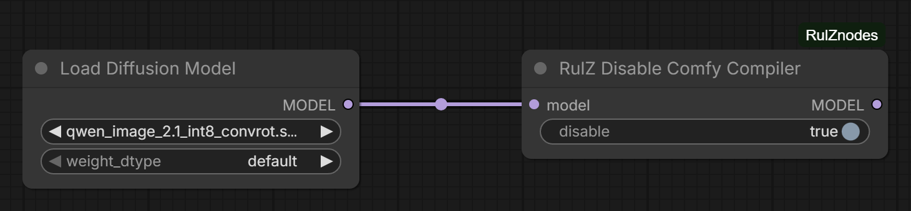

`DisableComfyCompiler`: a per-workflow replacement for the `--disable-comfy-compiler` launch flag.

The node takes a `MODEL` and returns a clone that turns the Comfy model compiler (and its CUDA graph
subfeature) off only while that model's diffusion forward pass runs. The flags are restored afterwards, so
other workflows are unaffected. `disable` is on by default; set it to off to pass the model through untouched.

Start ComfyUI without `--disable-comfy-compiler` and place the node right before the sampler, after any other
nodes that patch the model. It keeps model wrappers set before it, but a node after it that sets its own model
function wrapper replaces it.

- Tested on ComfyUI 0.37.0 with Qwen Image 2.1.
- Only the diffusion model is covered; text encoders, the VAE and latent previews are not affected.

## RulZ Random Prompt Selector

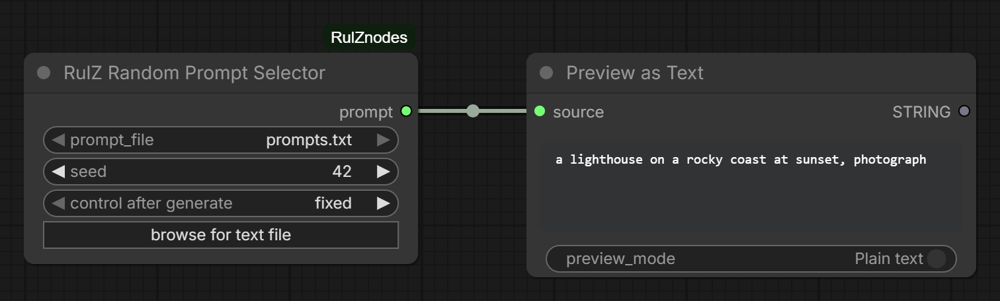

`RandomPromptSelector`: outputs one line from a text file of prompts, chosen by the seed.

| Input | Description |
|---|---|
| `prompt_file` | The `.txt` file to read, one prompt per line. Lists the `.txt` files at the top level of ComfyUI's `input` folder. |
| `seed` | Picks the line. The same seed and file always give the same prompt. Adding or removing lines changes which line a seed picks. |

**Output:** `prompt`.

- **browse for text file** uploads a file from your computer into ComfyUI's `input` folder and selects it.
  Browsers can't give a node the path of a local file, so the node reads that copy: after editing the original,
  browse for it again to replace the copy. A file with the same name in `input` is overwritten.
- The file is read as UTF-8 (a byte order mark is fine). Blank lines and spaces around a line are ignored. A
  file with no prompts stops the run with an error.
- Set `control after generate` to `randomize` for a new prompt each run, or `fixed` to keep the same one. Editing
  the file in `input` is picked up on the next run.

## RulZ Person Select (SAM3)

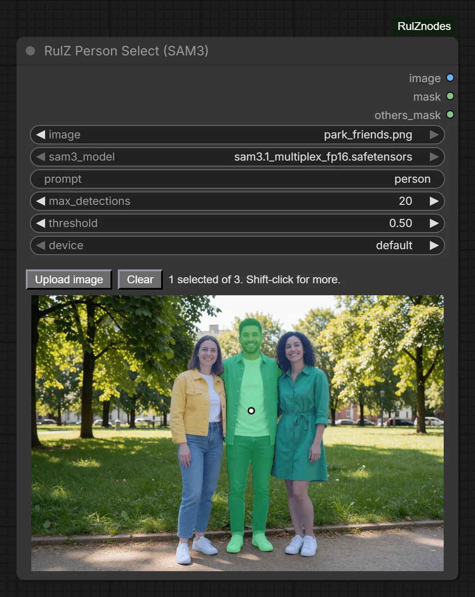

`RulZPersonSelect`: an image loader with a clickable preview. SAM 3 finds every person in the image, the node
tints each one, and the one you click becomes the mask.

Needs a ComfyUI version with built-in SAM 3 support (the **SAM3 Detect** node) and a SAM 3 or SAM 3.1
checkpoint in `models/checkpoints`. Nothing else is installed or downloaded. Without SAM 3 support the node
still appears, and the preview and runs stop with an error that asks you to update ComfyUI.

| Input | Description |
|---|---|
| `image` | The image to load, from ComfyUI's `input` folder. **Upload image** or dropping a file on the node adds one (the first file, if you drop several). HEIC/HEIF works when `pillow-heif` is installed. |
| `sam3_model` | The SAM 3 checkpoint. Lists every checkpoint, with names containing "sam" first; any other file gives an error. The node loads it itself; no loader node is needed. |
| `prompt` | What SAM 3 looks for. Default `person`; empty also means `person`. Separate several things with commas, e.g. `person, dog`. A part can set its own maximum, e.g. `person:5, dog:2`. |
| `max_detections` | Most matches to find per prompt part. 1 to 64, default `20`. |
| `threshold` | Detection confidence. Lower it if someone is not found. 0 to 1, default `0.5`. |
| `device` | Where SAM 3 runs. `default` is ComfyUI's main GPU. Pick another GPU (listed by name) to click and queue images while a workflow is using the main GPU. |

**Outputs:** `image` (the first frame, for files with several), `mask` (what you clicked), `others_mask`
(everything else that was detected, minus what you clicked).

- The selected person is tinted green, the others found blue, and the one under the pointer yellow.
- **Click** a person to select only them. Clicking the only selected person again deselects them.
- **Shift-click** (or Ctrl/Cmd-click) adds or removes a person, so several can be selected.
- Clicking something that was not detected asks SAM 3 for whatever is at that point and selects that. Where two
  people overlap, the click picks the smaller one. A click that finds nothing shows as a red dot.
- **Clear** removes the selection. The status line next to it says how many were found and selected, or why
  the preview is waiting.
- The selection is saved with the workflow as click positions, so it is cleared when you change the image.
- The preview runs SAM 3 when the image or a setting changes: a few seconds the first time while the model
  loads, then about 3 seconds per new image on `default` and about a second on a second GPU. On `default` it
  waits while a workflow is running and tries again every few seconds.
- What SAM 3 found is kept for each image, so changing `threshold` or `max_detections` takes a fraction of a
  second: only people that were not shown before are worked out. Going back to an earlier image or prompt is
  quick too. The kept results take about 0.2 GB of RAM for a 12 MP photo and 0.35 GB for a 94 MP one (about
  35 MB more for each extra prompt), and at most 1 GB together; the newest image is always kept, even past that.
- Clicks and setting changes made while the preview is still busy don't pile up: only the newest one is worked
  out. One SAM 3 pass runs at a time.
- SAM 3 runs on the node's own copy of the model, outside ComfyUI's model management. On `default` that copy
  waits in RAM (about 1.7 GB) and is moved to the main GPU only while it runs, so it never holds VRAM your
  workflows need. Before a queued run on `default` the node asks ComfyUI to free about 3 GB of VRAM, which can
  unload other models. Picking another `sam3_model` drops the old copy.
- The SAM 3 text encoder runs on the CPU, once per prompt, whatever the `device`.
- Queuing with nothing selected stops the workflow with an error, so an empty mask is never passed on. So does
  queuing when the clicked points found nothing: click the person again.
- If the GPU has too little free VRAM for SAM 3, the error says so and suggests another GPU or waiting until
  the workflow using it has finished.

**Using a second GPU (`device`):**

- The preview runs right away even while a workflow is running, so you can pick the person in the next image
  and queue it without waiting. The queued run itself still waits its turn, because ComfyUI runs one workflow
  at a time.
- The node's copy of SAM 3 stays on that GPU (about 1.3 GB of VRAM, plus about 1 GB while it runs).
  ComfyUI does not count that memory, so if your workflows also use that GPU (multi-GPU nodes, for example)
  they share its VRAM. Switching `device` back to `default` frees it with the next preview, which the switch
  starts.
- GPUs are listed by name, not number, because the numbering changes with launch flags such as
  `--default-device`. A saved workflow keeps pointing at the same card. Two identical cards are told apart by
  their PCI bus.
- Picking the main GPU by name is the same as `default`. If the saved GPU is not available (for example
  hidden by `--cuda-device`), the node uses the main GPU instead of failing.
- Cancelling the running workflow still works while a preview runs on the other GPU.

## RulZ Qwen Sparse Sage Attention

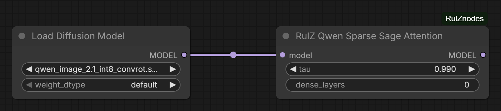

`QwenSparseSageAttention`: block-sparse SageAttention 2 for Qwen Image 2.1.

From the second sampling step on, Qwen Image 2.1 reuses cached text and reference-image keys, and the image being
generated puts most of its attention on a minority of them. On that step the node estimates, for every layer,
head and block of 128 queries (separately for the positive and negative prompt), the fewest 64-token key blocks
that hold `tau` of the attention. Text blocks are always kept. For the rest of the run it computes only those
blocks, with a copy of SageAttention's kernel that skips the others. With every block kept the kernel is as
accurate as SageAttention (the same error against exact attention in testing, though not bit-for-bit the same
output).

| Input | Description |
|---|---|
| `model` | A Qwen Image 2.1 model. Other models are not made sparse: their attention runs dense as described below (SageAttention where it applies), and the console says so. |
| `tau` | Share of the estimated attention kept. 0.9 to 1, default `0.99`, which matched plain SageAttention's quality in testing; lower is faster and less exact. |
| `dense_layers` | Transformer blocks that always run dense, e.g. `0, 30-31`. Default `0`: block 0 attends almost everywhere. |

**Output:** `model`.

Use it instead of **Patch Sage Attention KJ**, or after it. Whatever the node doesn't make sparse runs dense:
the first step, masked attention, the `dense_layers`, layers where the estimate keeps more than 85% of the
blocks anyway, and attention that isn't fp16 / bf16 with a head size of 64 or 128. Dense attention goes through
the attention patch before this node if there is one; otherwise unmasked fp16 / bf16 attention uses
SageAttention and the rest uses ComfyUI's own attention. A Sage patch placed after this node replaces it.

After the second step the console reports how many layers run sparse and the average share of key blocks
they keep.

On an RTX 5060 Ti with an int8 Qwen Image 2.1 Edit model, 8 steps at 1728x2304 (4 MP) with one 4 MP reference,
sampling steps took 3.45 s instead of 4.5 s, and the output matched plain SageAttention as closely as SageAttention
matches full-precision attention. At 1 MP the steps are about 18% faster, but the one-time block estimate on the
second step takes most of that back.

Flux 2 (Klein) is not made sparse by this node: every token, reference included, attends every other token, and
ComfyUI's built-in **Model Sparse Attention** node (method `sol-attn`) handles that layout faster. With Klein 9B
int8 at 1792x2336 and a 4 MP reference, 4 steps, it took steps from 10.8 s to 8.4 s on an RTX 5060 Ti and from 14.4 s
to 10.8 s on an RTX 4060 Ti at `tau` 0.8, with no visible change.

- Needs SageAttention 2 (`sageattention`, tested with 2.2) and an RTX 40 (sm89) or RTX 50 / DGX Spark (sm120 /
  sm121) GPU.
- Needs the CUDA toolkit (`nvcc`), `ninja` and a C++ compiler: the first run builds the kernel, which takes 2 to
  3 minutes, and later runs load it. Without them, or on other GPUs, attention stays dense and the console says
  why. A failed build is not tried again until ComfyUI restarts.
- Tested on Linux (WSL2) with ComfyUI 0.44.0, PyTorch 2.15 and CUDA 13.4.

## Credits

RulZ Resize Image Advanced is based on the Resize Image v2 node, its pad helpers and its colour parser from
[ComfyUI-KJNodes](https://github.com/kijai/ComfyUI-KJNodes) by kijai.

RulZ DeskinTexture is based on ComfyUI-DeSkin 1.4.0 (MIT).

RulZ Qwen Sparse Sage Attention's kernel in `sparse_sage/csrc` is SageAttention 2
([thu-ml/SageAttention](https://github.com/thu-ml/SageAttention)), changed to skip key blocks.

The photos in the screenshots were generated for this README.

## License

[GPL-3.0](https://github.com/speedyrulz/ComfyUI-RulZnodes/blob/main/LICENSE). RulZ Resize Image Advanced is
derived from GPL-3.0 code in ComfyUI-KJNodes, so the pack as a whole is released under the same license.
`sparse_sage/csrc` keeps SageAttention's
[Apache-2.0](https://github.com/speedyrulz/ComfyUI-RulZnodes/blob/main/sparse_sage/LICENSE) license.
